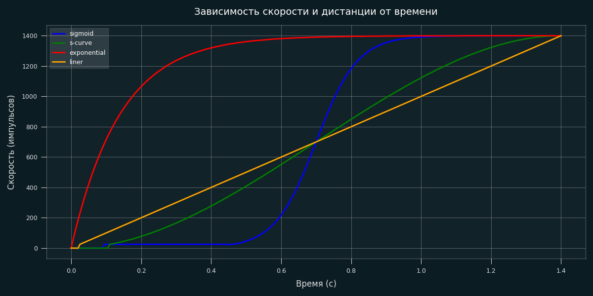

# Stepper

**Модульная библиотека плавного управления шаговым двигателем** для микроконтроллеров STM32.

Библиотека реализует **профилирование скорости** (speed profiling) — плавный разгон и торможение шагового двигателя по одному из четырёх математических законов: линейному, сигмоидальному, S-образному и экспоненциальному.

---

## 📌 Возможности

- ✅ **Полиморфизм через таблицы функций** — все три уровня (Stepper, Planner, Driver) используют единый паттерн "базовая структура + интерфейс".
- ✅ **4 алгоритма профилирования скорости** на выбор:
  - `Linear` — постоянный наклон (трапецеидальный профиль)
  - `Sigmoid` — логистическая кривая с компенсацией трения покоя
  - `S-curve` — полиномиальная интерполяция (Smoothstep, нулевые ускорения на концах)
  - `Exponential` — асимптотический выход на режим
- ✅ **Аппаратная абстракция** — драйвер отделён от планировщика, легко портируется на другие MCU (AVR, ESP32, и т.д.).
- ✅ **Генерация STEP-импульсов через PWM таймера** — минимальная загрузка CPU.
- ✅ **Атомарная смена направления** — DIR обновляется только в ISR по флагу `UIF`, что исключает ложные шаги.
- ✅ **"Мёртвая зона" (v_jump)** — компенсация трения покоя во всех планировщиках.
- ✅ **Защита от переполнения системного таймера** (32-битный `tick`).
- ✅ **Doxygen-совместимая документация** во всех файлах.

---

## 🏗 Архитектура

```
┌─────────────────────────────────────────────────────────────┐
│                    Пользовательский код                     │
│               Stepper_Itf.SetVel(&motor, 1000);             │
└───────────────────────────┬─────────────────────────────────┘
                            │
┌───────────────────────────▼─────────────────────────────────┐
│                  Stepper_t  (stepper.h/c)                   │
│   ┌──────────────────────┐   ┌──────────────────────────┐   │
│   │ StepperPlanner_t     │   │ StepperDriver_t          │   │
│   │  (алгоритм скорости) │   │  (аппаратный HAL)        │   │
│   └──────────┬───────────┘   └────────────┬─────────────┘   │
└──────────────┼────────────────────────────┼─────────────────┘
               │                            │
    ┌──────────▼──────────┐      ┌──────────▼──────────────┐
    │ Реализации:         │      │ Реализации:             │
    │  • Linear           │      │  • StepperDriverSTM32   │
    │  • Sigmoid          │      │  • (в будущем: AVR,     │
    │  • S-curve          │      │           ESP32, ...)   │
    │  • Exponential      │      │                         │
    └─────────────────────┘      └─────────────────────────┘
```

---

## 📁 Структура проекта

```
.
├── stepper.h / stepper.c                     # Высокоуровневый модуль управления
├── stepper_planner.h                         # Абстрактный интерфейс планировщика
├── stepper_driver.h                          # Абстрактный интерфейс драйвера
│
├── linear.h / linear.c                       # Линейный профиль
├── sigmoid.h / sigmoid.c                     # Сигмоидальный профиль
├── s-curve.h / s-curve.c                     # S-образный профиль (Smoothstep)
├── exponential.h / exponential.c             # Экспоненциальный профиль
│
├── stepper_driver_stm32.h / .c               # Реализация драйвера для STM32
└── stepper_driver_def_stm32.h                # Константы драйвера (каналы, разрядность)
```

---

## 📈 Графики профилей скорости

На графике ниже показано сравнение всех четырёх алгоритмов профилирования скорости при одинаковых параметрах (одинаковые начальная/целевая скорость и ускорение):



> **Что видно на графике:**
> - **Linear** — прямая линия, резкие изломы на концах (скачок ускорения).
> - **Sigmoid** — плавная S-образная кривая, симметричная относительно середины перехода.
> - **S-curve** — наиболее плавный профиль: нулевые ускорения в начале и в конце (нулевые производные на концах).
> - **Exponential** — быстрый выход на целевую скорость с асимптотическим приближением (никогда формально не достигает цели, но практически — за ~10 постоянных времени).

## 📊 Сравнение алгоритмов планирования

| Алгоритм        | Формула                                    | Плавность | Особенности                                  |
|-----------------|--------------------------------------------|-----------|----------------------------------------------|
| **Linear**      | `v(t) = v₀ + slope·t`                      | ★★☆☆☆     | Простой, скачок ускорения на концах          |
| **Sigmoid**     | `v(t) = v₀ + Δv / (1 + e^{-k(t-t₀)})`     | ★★★★☆     | Плавный S-профиль, "мёртвая зона" с компенсацией |
| **S-curve**     | `v(t) = v₀ + Δv·(3τ² - 2τ³)`              | ★★★★★     | Нулевые ускорения на концах, полином 3-й ст. |
| **Exponential** | `v(t) = v₁ - Δv·e^{-λt}`                   | ★★★☆☆     | Быстрый выход на режим, асимптотика          |

---

## 🚀 Быстрый старт

### 1. Подключение и инициализация

```c
#include "stepper.h"

// Экземпляр мотора
Stepper_t motor;

// Экземпляр настройки драйвера STM32
StepperDriverSTM32_t driver;

// Экземпляр настройка планировщика (например, S-кривая)
Scurve_t planner;

int main(void) {
    HAL_Init();
    SystemClock_Config();
    MX_GPIO_Init();
    
    __HAL_RCC_GPIOA_CLK_ENABLE();

    HAL_GPIO_WritePin(GPIOA, EN_Pin | DIR_Pin, GPIO_PIN_RESET);

    GPIO_InitStruct.Pin = EN_Pin | DIR_Pin;
    GPIO_InitStruct.Mode = GPIO_MODE_OUTPUT_PP;
    GPIO_InitStruct.Pull = GPIO_NOPULL;
    GPIO_InitStruct.Speed = GPIO_SPEED_FREQ_LOW;
    HAL_GPIO_Init(GPIOA, &GPIO_InitStruct);

    __HAL_RCC_TIM2_CLK_ENABLE();

    GPIO_InitStruct.Pin = PUL_Pin;
    GPIO_InitStruct.Mode = GPIO_MODE_AF_PP;
    GPIO_InitStruct.Speed = GPIO_SPEED_FREQ_LOW;
    HAL_GPIO_Init(PUL_GPIO_Port, &GPIO_InitStruct);

    // Инициализация мотора
    driver = (StepperDriverSTM32_t){
        .base.itf = &StepperDriver_Itf,
        .htim = {
            .Instance = TIM2,
            .Channel  = TIM_CHAN_1,
            .Bit      = TIM_32_BIT,
            .Clock    = 84000000,       // 84 МГц
            .IRQn     = TIM2_IRQn,
        },
        .dir = { .Port = GPIOA, .Pin = GPIO_PIN_5 },
        .en  = { .Port = GPIOA, .Pin = GPIO_PIN_6 },
        .GetTick = HAL_GetTick,
    };
    
    planner = (Scurve_t){
        .base.itf = &Scurve_Itf,
        .a       = 5000,      // ускорение 5000 шаг/с²
        .v_jump  = 100,       // мёртвая зона 100 шаг/с
    };
    
    Stepper_Itf.Init(&motor, (StepperDriver_t*)&driver, (StepperPlanner_t*)&planner);
    Stepper_Itf.Enable(&motor);
    
    HAL_NVIC_SetPriority(TIM2_IRQn, 0, 0);
    HAL_NVIC_EnableIRQ(TIM2_IRQn);

    while (1) {
        // Периодический вызов планировщика
        Stepper_Itf.TaskPlanner(&motor);
        HAL_Delay(1);
    }
}
```

### 2. Управление скоростью

```c
// Плавный разгон до 3000 шаг/с
Stepper_Itf.SetVel(&motor, 3000);

// Реверс
Stepper_Itf.SetVel(&motor, -2000);

// Аварийная остановка
Stepper_Itf.Stop(&motor);

// Отключение питания (только если cur_vel == 0)
Stepper_Itf.Disable(&motor);
```

### 3. Обработчик прерывания таймера

```c
void TIM2_IRQHandler(void) {
    Stepper_Itf.TIMx_IRQHandler(&motor);
}
```

---

## 🔧 Настройка планировщика

Каждый планировщик имеет свои параметры, которые можно менять "на лету":

```c
// Смена алгоритма (подменяем таблицу функций)
planner.base.itf = &Linear_Itf;        // или &Sigmoid_Itf, &Scurve_Itf, &Exponential_Itf

// Изменение ускорения
Stepper_Itf.SetAcc(&motor, 10000);     // 10000 шаг/с²
```

---

## ⚙️ Зависимости

- **STM32 HAL** (для драйвера STM32) — `main.h`, регистры `TIM`, `GPIO`, `NVIC`
- **math.h** — `expf`, `logf`, `roundf`, `fabsf` (для планировщиков)
- **stdint.h / stdbool.h** — стандартные типы C99

---

## 📐 Принцип работы драйвера STM32

1. Таймер настраивается в режим **PWM Mode 1** со скважностью **50%** (`CCR = (ARR+1)/2`).
2. Частота PWM = модуль скорости (шаг/с): `ARR = TIM_CLK / (freq · (PSC+1)) - 1`.
3. Предделитель `PSC = 0` — вся грубая настройка через `ARR`.
4. **Направление (DIR)** обновляется в ISR по флагу `UIF` (Update) — строго в момент начала нового периода PWM. Это исключает генерацию "коротких" ложных шагов при смене направления.
5. При обновлении `ARR/CCR/DIR` прерывания NVIC временно запрещаются — атомарность гарантирована.

---

## 📝 Лицензия

Проект распространяется "как есть". Автор: **p0bedimka** (2026).
